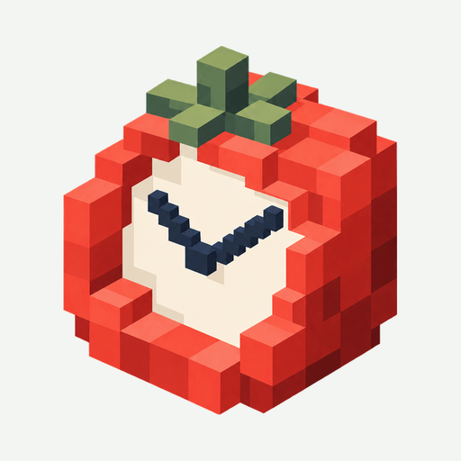

<p align="center">
  
</p>

# Blockcolc / 方块钟

[简体中文](README.md) · [English](README.en.md)

Blockcolc is a local-first Android focus timer that turns time spent into a block-built world. Report progress on subtasks to build a project, or complete focus rounds to grow a habit. From version 3.0, timing, storage, the interface and world rendering all run in the native Android app.

## Features

- Fixed rounds, end-time plans, a minimal clock and immersive focus. Optional automatic continuation, overtime, focus protection and system reminders.
- Daily goals, a focus heatmap and time per task. Completed buildings keep a record of the work behind them, and achievements unlock study furnishings.
- Four settlements, an indoor study, animals, day and night, and weather. The Paper Cut preset reduces rendering load.
- A library of built-in, reward and imported blueprints with `.litematic` previews and import. Minecraft Java Edition 26.3 packs can provide models, textures, tinting and animations. Supported block entities also have static displays.
- JSON import and export, a merged daily backup and rollback points. Optional accounts sync records and preferences across devices, provide cloud backups and support friend activity sharing.
- Simplified Chinese and English, pixel, system and mixed fonts, optional quick notes, date countdowns, nature recordings and rain audio that follows the weather.

## Install and run

Download the Android APK from [GitHub Releases](https://github.com/Dieight/blockcolc/releases). Existing users can export a JSON backup before upgrading in place with the same signing certificate. To receive previews, turn on **Join beta testing** in **Settings → Advanced & data**.

Local builds use Node.js 24, JDK 21, Android SDK 35 and Filament 1.56.0's `matc`.

```powershell
npm ci
.\apps\android\android\gradlew.bat -p apps/native-android :app:assembleDebug '-PmatcPath=C:\dev\filament\bin\matc.exe'
```

See the [native Android project](apps/native-android/README.md) for module details, configuration and verification. The repository keeps the earlier Web and Android projects for migration comparisons and recovery.

Change the app language in **Settings → App language**. The two choices always read **简体中文 / English**.
Language and font changes apply immediately; your project names, imported blueprint names and notes are not translated.

## Data and attribution

Blockcolc works offline by default. Signing in allows tasks, focus records and supported preferences to sync. Imported texture packs and audio stay on the device. Enable friends separately and choose whether to share status, the current task, start and end times, or daily focus time. Real weather is also opt-in. [Cloud terms and privacy](services/cloud/policy/en.md)

The app validates imported resources locally and uses supported block entity data for static display.

Minecraft is a trademark of Mojang Studios. This project is not affiliated with Mojang Studios or Microsoft and does not bundle
unauthorized original Minecraft textures, fonts, sounds or models. Existing backup formats and database identifiers remain
compatible across the project rename.

## Technology and sources

The project source is licensed under [Apache-2.0](LICENSE). Dependencies retain their own licenses.

| Technology | Use | Upstream |
| --- | --- | --- |
| Kotlin, Jetpack Compose | Native interface, timing and Android integration | [Kotlin](https://kotlinlang.org/) · [Compose](https://developer.android.com/compose) |
| Filament, OpenGL ES | Block world, shadows, transparent materials and same-frame glass | [Filament](https://github.com/google/filament) |
| SQLite, Node.js | Local storage and rollback, plus optional accounts, friends and cloud backups | [SQLite](https://www.sqlite.org/) · [Node.js](https://nodejs.org/) |
| Fusion Pixel | Chinese and English pixel fonts | [Fusion Pixel](https://github.com/TakWolf/fusion-pixel-font) |
| TypeScript, React, Three.js | Earlier client, migration reference and asset tools | [TypeScript](https://github.com/microsoft/TypeScript) · [React](https://github.com/facebook/react) · [Three.js](https://github.com/mrdoob/three.js) |
| SunCalc 2.0.2 | Solar/lunar positions, moon phase and illuminated-limb angle | [SunCalc](https://github.com/mourner/suncalc), [BSD-2-Clause license](apps/web/public/licenses/suncalc.txt) |
| lunar-typescript 1.8.6 | Offline lunar-calendar holiday dates | [lunar-typescript](https://github.com/6tail/lunar-typescript), [MIT license](apps/web/public/licenses/lunar-typescript/LICENSE.txt) |
| fflate | Local ZIP/GZIP decoding for resource packs and Litematic | [fflate](https://github.com/101arrowz/fflate) |
| Lucide | Interface icons | [Lucide](https://github.com/lucide-icons/lucide) |
| Vite, Vitest, Playwright | Building, unit tests and browser interaction tests | [Vite](https://github.com/vitejs/vite), [Vitest](https://github.com/vitest-dev/vitest), [Playwright](https://github.com/microsoft/playwright) |

Optional real weather uses the [QWeather API](https://dev.qweather.com/en/docs/).
World generation is implemented in this project, with Minecraft block forms and environments as references; it is not the Minecraft generator.
Imported packs and blueprints remain subject to their authors' licenses.
See [design sources](docs/assets/design-sources.md), [supplemental blueprints](docs/assets/local-blueprints.md) and
[recorded audio sources and processing](docs/assets/ambient-audio.md).
SunCalc's copyright notice and full license ship with the app and have their own About link; they are separate from Blockcolc's license.

## Project documents

- [Product behavior](BLOCKCOLC.md)
- [Current work](docs/TODO.md)
- [Verification and delivery](docs/TESTING.md)
- [Workspace maintenance](docs/WORKSPACE-MAINTENANCE.md)
- [Version records](docs/versions/README.md)
